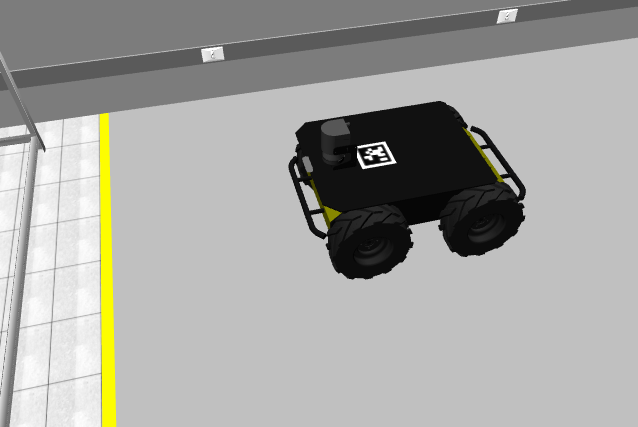
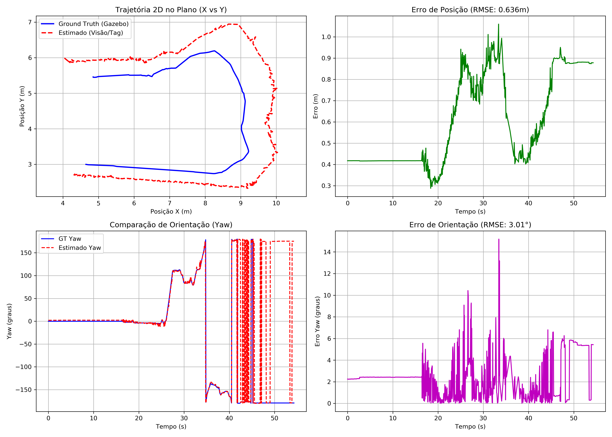

# Husky Visual Localization with AprilTag

Ferramenta baseada em ROS (Noetic) para **localização global de alta precisão** e **validação de trajetória** de um robô **Husky** no Gazebo, usando uma **câmera de topo**, **AprilTags** e comparação em tempo real com o **Ground Truth**, com métricas **RMSE** e geração automática de gráficos.

Uma AprilTag (`tag36_11_00000`, 15x15 cm) é fixada na placa superior do Husky. Uma câmera fixa, posicionada acima do ambiente do laboratório (LaR), detecta a tag e estima a **pose (posição + orientação)** do robô. A estimativa é comparada com o ground truth publicado pelo Gazebo para quantificar o erro.

<p align="center">
  
</p>

> Este repositório é baseado no [lar_gazebo (branch `noetic`)](https://github.com/lar-deeufba/lar_gazebo/tree/noetic), do LaR/UFBA. Os arquivos necessários foram incluídos aqui para que seja possível reproduzir todo o ambiente **sem baixar outro repositório**.

## Sumário

- [Vídeo demonstrativo](#vídeo-demonstrativo)
- [Estrutura do repositório](#estrutura-do-repositório)
- [Como os arquivos se conectam](#como-os-arquivos-se-conectam)
- [Algoritmo passo a passo](#algoritmo-passo-a-passo)
- [Instalação](#instalação)
- [Execução](#execução)
- [Gravação e reprodução de rosbag](#gravação-e-reprodução-de-rosbag)
- [Resultados](#resultados)
- [Créditos e licença](#créditos-e-licença)

> ## Vídeo demonstrativo

🎥 [Assista ao vídeo demonstrativo](https://drive.google.com/file/d/1SvBjmx_TUE_7cTFdMKdr_Ni-vqec00XJ/view?usp=drivesdk)

## Estrutura do repositório

```
.
├── docker/                  # arquivos de build do ambiente Docker
├── husky_urdf_extras/       # URDF/Xacro extras do Husky (AprilTag, câmera de topo, ground truth)
├── launch/                  # arquivos de launch (ex.: lar_husky.launch)
├── models/                  # modelos do Gazebo (ex.: tag36_11_00000: SDF + malha .dae + textura .png)
├── scripts/                 # run_husky.sh, shell.sh e nós Python (tag_pose_estimator.py, pose_validator.py)
├── worlds/                  # mundos do Gazebo (lar.world)
├── CMakeLists.txt
├── package.xml
├── docker-compose.yml
├── husky_accessories.sh
├── LICENSE                  # MIT
└── README.md
```

## Como os arquivos se conectam

| Arquivo | Papel |
|---|---|
| `tag36_11_00000.dae` | Malha 3D (Collada) e textura da AprilTag. A matriz de transformação foi corrigida para que a textura fique voltada para cima e com as proporções físicas corretas (15x15 cm). |
| `apriltag_sensor.urdf` | Define a AprilTag como link no ROS: referencia o `.dae` via `<mesh filename="package://..."/>`, define colisão (`<collision>`), massa e inércia (`<inertial>`) e cria o **joint fixo** com o `top_plate_link` do Husky. |
| `model.sdf` / `model_visao.sdf` | Descrição nativa do Gazebo da AprilTag como modelo standalone/estático, usando `model://tag36_11_00000/meshes/...` para que o OGRE aplique materiais, iluminação e sombras corretamente. |
| `husky_...xacro` | Orquestrador principal: usa `<xacro:include>` para incluir o URDF da AprilTag e o `gazebo_ground_truth.urdf` (plugin que publica a pose real do robô nos tópicos do ROS). |
| `overhead_camera.urdf.xacro` | Câmera de topo com propriedades físicas e plugin do Gazebo, instanciada como modelo estático em altura elevada e com campo de visão ajustado para cobrir todo o laboratório. |
| `lar_husky.launch` | Controlador central: carrega `lar.world`, faz o spawn do Husky e lê o URDF da câmera de topo para posicioná-la na simulação. |
| `lar.world` | Mundo do laboratório. As AprilTags antigas foram removidas, restando apenas a tag do robô. |

**Fluxo em uma linha:** o **Xacro** combina o **ground truth** com o **URDF da tag**, que referencia a geometria do **`.dae`** (renderizada via **SDF/Gazebo**), de modo que o robô é gerado completo, com a tag visualmente correta no topo e publicando telemetria no ROS.

## Algoritmo passo a passo

1. **Simulação:** o `lar_husky.launch` carrega o mundo, o Husky (com a tag) e a câmera de topo.
2. **Aquisição:** `pose_validator.py` assina a imagem da câmera de topo (`/overhead_camera/image_raw`) e compara estimativa e ground truth, calcula o erro (RMSE) e gera os gráficos.
3. **Detecção:** a AprilTag é detectada com a biblioteca `pupil-apriltags`.
4. **Estimação de pose:** a partir da detecção e dos parâmetros da câmera, é calculada a pose (posição e orientação) da tag e, portanto, do robô.
5. **Referência:** o ground truth é lido de `/gazebo/model_states`.

## Instalação

### Pré-requisitos

- [Docker](https://docs.docker.com/get-docker/) e [Docker Compose](https://docs.docker.com/compose/install/)
- Git

### Clonar o repositório

```bash
git clone https://github.com/lanjos1/Husky_Visual_Localization_with_AprilTag.git
cd Husky_Visual_Localization_with_AprilTag
```

### Preparar o ambiente

> ⚠️ **Importante:** o projeto roda dentro de um container Docker. Sempre que for executar ou alterar algo **dentro do Docker**, abra primeiro o shell interativo:
>
> ```bash
> ./scripts/shell.sh
> ```

Dentro do shell interativo, instale as dependências Python:

```bash
python3 -m pip install pupil-apriltags
python3 -m pip install --upgrade numpy
pip3 install scipy
```

Em seguida, vá até a pasta dos scripts e dê permissão de execução:

```bash
cd src/lar_gazebo/scripts
chmod +x pose_validator.py
```

## Execução

Use um terminal para cada passo. Os terminais que executam comandos ROS devem estar dentro do shell interativo (`./scripts/shell.sh`).

**1. Abrir o Husky no mundo do laboratório**

```bash
./scripts/run_husky.sh
```

**2. Abrir o shell interativo** (um por terminal adicional)

```bash
./scripts/shell.sh
```

**3. Visualizar a câmera de topo**

```bash
rqt_image_view /overhead_camera/image_raw
```

**4. Iniciar a estimação de pose e a validação**

```bash
cd src/lar_gazebo/scripts
rosrun lar_gazebo pose_validator.py
```

**5. Controlar o robô (teleop)**

```bash
rosrun teleop_twist_keyboard teleop_twist_keyboard.py
```

**Comandos úteis**

```bash
rostopic list                                # listar tópicos
rostopic echo /gazebo/model_states -n 1      # posição real dos objetos no ambiente
```

## Gravação e reprodução de rosbag

```bash
# Gravar
rosbag record -O teste_trajetoria.bag /cmd_vel /gazebo/model_states

# Reproduzir
rosbag play teste_trajetoria.bag
```

## Resultados



| Métrica | Valor |
|---|---|
| RMSE de posição | 0,636 m |
| RMSE de orientação (yaw) | 3,01° |

**Observações:**

- O yaw estimado acompanha bem o ground truth, com erros em geral abaixo de 6°. Há picos pontuais de até ~15°.
- O erro de posição é de ~0,42 m com o robô parado (0 a ~16 s) e depois oscila entre 0,3 m e 1,0 m. Um offset constante com o robô parado sugere um erro sistemático de calibração (parâmetros intrínsecos/extrínsecos da câmera, altura da câmera ou da tag, ou frame de referência), e não ruído de detecção.
- A trajetória estimada tem forma parecida com a real, mas deslocada e ampliada. Isso é compatível com erro de escala ou de altura da câmera, porque o erro cresce longe do centro da imagem.
- Limitações: dependência de a tag estar visível e sem oclusão.
  
## Créditos e licença

- Base do projeto: [lar-deeufba/lar_gazebo (noetic)](https://github.com/lar-deeufba/lar_gazebo/tree/noetic), Laboratório de Robótica (LaR) da UFBA.
- Autora: **Ludmila**: [GitHub](https://github.com/lanjos1) · [Portfólio](https://lanjos1.github.io/)
- Licença: [MIT](LICENSE)
